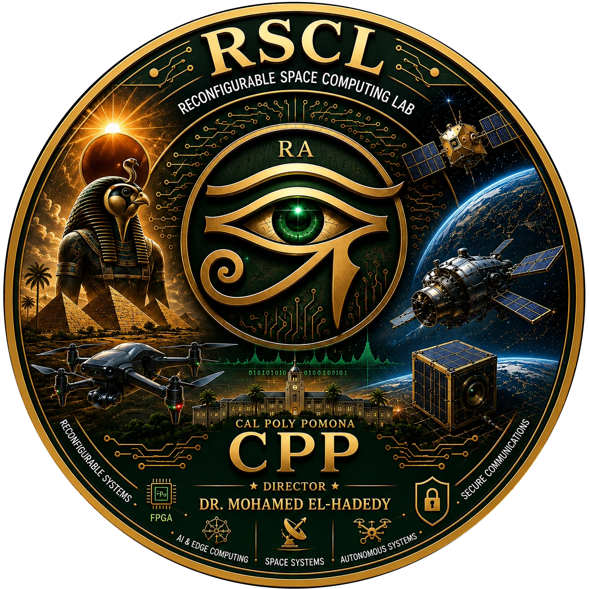
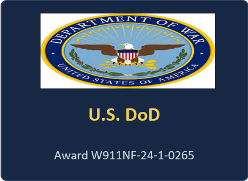
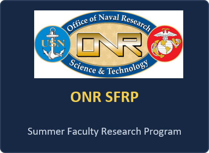

<p align="center">
  
</p>

<h1 align="center">HU–MA'AT</h1>
<p align="center"><b>Trustworthy Natural-Language Control of a Drone Fleet</b><br>
Reconfigurable Space Computing Lab (RSCL) · California State Polytechnic University, Pomona<br>
IEEE Telepresence 2026 · Demonstration 7</p>

---

Talk to a fleet of drones in plain English — *"Horus, take off"*, *"Everyone except Anubis, hover"*,
*"All form a circle"* — and watch the system decide, **before anything moves**, whether to:

| Decision | Meaning |
|---|---|
| 🟢 **EXECUTE** | HU is confident (≥ 0.85) — the command is sent to the safety supervisor |
| 🟡 **CONFIRM** | HU is unsure (0.55 – 0.85) — a human must press *Confirm* first |
| 🔴 **REFUSE** | Not a safe or valid flight command — nothing moves |

- **HU** is the language layer: a frozen SmolLM2-135M encoder with small trained heads (action, target, compound).
- **MA'AT** is the independent safety supervisor: the *only* component allowed to move an aircraft. It
  re-checks every command against live telemetry (separation, arena bounds, altitude, faults).
- **Emergency words** (*"stop"*, *"land now"*, *"khalas"*, Arabic for "enough") bypass every language model and act fleet-wide.

This repository runs five simulated quadcopters — **Horus, Ra, Thoth, Anubis, Osiris** — in Gazebo Harmonic.

> **Scope.** The HU paper's experimental results were obtained on a *physical three-drone fleet*. This
> package runs the same frozen HU model and safety pipeline on *simulated* aircraft. Simulated values
> (e.g. battery) are labelled as such everywhere.

---

## Contents

1. [Install (one time)](#1-install-one-time)
2. [Start the demo](#2-start-the-demo)
3. [Try it — example commands](#3-try-it--example-commands)
4. [Change the environment](#4-change-the-environment)
5. [Talk to the drones (SwarmChat)](#5-talk-to-the-drones-swarmchat)
6. [Stop, status and troubleshooting](#6-stop-status-and-troubleshooting)
7. [Verify everything (acceptance tests)](#7-verify-everything-acceptance-tests)
8. [How it works](#8-how-it-works)
9. [Repository layout](#9-repository-layout)
10. [Acknowledgments](#acknowledgments)

---

## 1. Install (one time)

Tested on **Windows 11 + WSL2 Ubuntu 24.04** (native Ubuntu 24.04 also works). 8+ CPU cores and 16 GB RAM
recommended. No GPU needed.

**a) Gazebo Harmonic and Python bindings**

```bash
sudo apt update
sudo apt install -y gz-harmonic python3-gz-transport13 python3-gz-msgs10 python3-pip python3-venv curl
```

**b) This repository** — clone it to `~/hu-telepresence-gazebo` (the launcher expects that path):

```bash
git clone https://github.com/mealycpp/hu-maat-trustworthy-drone-control.git ~/hu-telepresence-gazebo
```

**c) Python environment for HU and the chat service**

```bash
python3 -m venv ~/hu-telepresence-gazebo/hu-venv
~/hu-telepresence-gazebo/hu-venv/bin/pip install --index-url https://download.pytorch.org/whl/cpu torch
~/hu-telepresence-gazebo/hu-venv/bin/pip install "transformers>=4.45" pyyaml
```

**d) Language models** (downloaded once; afterwards everything runs offline)

```bash
~/hu-telepresence-gazebo/hu-venv/bin/python -c "from huggingface_hub import snapshot_download as d; [print(d(m)) for m in ['HuggingFaceTB/SmolLM2-135M','HuggingFaceTB/SmolLM2-135M-Instruct','HuggingFaceTB/SmolLM2-360M-Instruct']]"
```

**e) HU research code and trained heads** — the HU package and its checkpoint
(`hu_heads_v1_1_REGISTERS.pt`) live in the separate RSCL repository `rscl-hu-latest`, expected at
`~/rscl-hu-latest`. Contact RSCL for access.

The first launch also downloads the X3 quadcopter meshes from Gazebo Fuel (needs internet once).

---

## 2. Start the demo

```bash
bash ~/hu-telepresence-gazebo/hu_maat.sh start --env military
```

Wait for `VERDICT: READY` (about 1–3 minutes). Then open:

| Page | URL | What it is |
|---|---|---|
| **HU console** | <http://localhost:8100> | Type or speak commands here |
| **SpaceOps** | <http://localhost:8766> | Ground station: health curves, formations, latency, faults, chat, exports |
| Flight supervisor | <http://localhost:8765> | MA'AT status (read-only) |

`READY (DEGRADED: chat LLM not loaded)` is fine — flying does not depend on the chat model.

---

## 3. Try it — example commands

> 📋 **Full list of everything you can try** (every move, turn, all 25 formations, refusals, emergency words,
> chat questions): **[docs/TRY_IT.md](docs/TRY_IT.md)**

Type these in the HU console (or press the microphone and say them). Go roughly in this order:

| # | Say / type | Expected | What it shows |
|---|---|---|---|
| 1 | `Horus, take off` | 🟢 EXECUTE | Named single-drone command |
| 2 | `Ra and Thoth, take off` | 🟢 EXECUTE | Group targeting |
| 3 | `Everyone, take off` | 🟢 EXECUTE | Staggered layered takeoff — close drones wait their turn |
| 4 | `Horus, move forward 1 meter` | 🟡 CONFIRM | Distances go through the deterministic parser and always need a human |
| 5 | `Ra, turn left 90 degrees` | 🟡 CONFIRM | Rotation |
| 6 | `All form a circle` | 🟡 CONFIRM | Formation with separation-checked slot assignment |
| 7 | `All form a V` / `line` / `diamond` / `star` | 🟡 CONFIRM | 25 validated formations |
| 8 | `Everyone move right 1 meter` | 🟡 CONFIRM | Swarm travel — the formation is kept |
| 9 | `Everyone except Anubis, hover` | 🟢/🟡 | Exclusion targeting |
| 10 | `This project is really taking off` | 🔴 REFUSE | Not a command, even though it contains "taking off" |
| 11 | `Thoth, do a backflip` | 🔴 REFUSE | Outside the authorized flight envelope |
| 11b | `Horus, take off and move forward 1 meter` | 🔴 REFUSE | One action per command |
| 12 | `Stop` or `All, khalas` | ⛔ EMERGENCY HOLD | Fleet-wide, no language model involved |
| 13 | `Everyone, land` | 🟢 EXECUTE | Landing |

**Emergency words always work, from any state:**

- Hold position (whole fleet): `stop` · `all stop` · `abort` · `khalas`
- Land (whole fleet): `land now` · `everyone down` · `emergency land`

A plain `land` with no target is *not* an emergency — say `Everyone, land` or name a drone.

A command marked as *sent* is not counted as done: SpaceOps only reports success once Gazebo telemetry
confirms the aircraft actually reached the goal.

---

## 4. Change the environment

Land all drones first, then:

```bash
bash ~/hu-telepresence-gazebo/hu_maat.sh env forest
```

| Name | Scenery |
|---|---|
| `festival` | Original festival stage |
| `forest` | Trees and clearings |
| `military` | Military training range |
| `mountains` | Mountain valley |

Scenery is visual only and kept outside the 5 m flight zone, so behaviour is identical in every world.
Gazebo restarts (1–2 minutes); wait for `READY` again.

---

## 5. Talk to the drones (SwarmChat)

In SpaceOps, open the chat panel and talk to the fleet or a single drone:

```
How are you all doing?
Horus, what is your battery?
Ra, what's your favourite formation?
Thoth, do you actually understand me?
Who is the best drone?
Team, can you inspect the north sector?
```

- **Chat can never move an aircraft.** Requests to fly are answered with a refusal plus a preview of what the
  command *would* be; flying happens only through the HU console.
- Every message carries a **source badge** so nothing is passed off as something it isn't:
  `TELEMETRY_FACT`, `HU_TRAINED`, `MISSION_DETERMINISTIC`, `DETERMINISTIC_AGENT_POLICY`, `CHAT_LOCAL_LLM`,
  `RULES_PERSONA`, `SAFETY_SUPERVISOR`.
- Facts (battery, altitude, tracking error, faults) come from live telemetry. An optional local
  SmolLM2-Instruct model may reword replies; every generated reply is checked by a grounding validator and
  replaced by the deterministic reply if it invents anything.
- *"Team, can you inspect the north sector?"* shows the mission coordinator: drones bid for roles, MA'AT
  checks the plan, and it is **plan only** until an operator approves it.

Choose the optional chat model (restarts only the chat service):

```bash
bash ~/hu-telepresence-gazebo/hu_maat.sh chat-model HuggingFaceTB/SmolLM2-360M-Instruct
```

---

## 6. Stop, status and troubleshooting

```bash
bash ~/hu-telepresence-gazebo/hu_maat.sh status
```

```bash
bash ~/hu-telepresence-gazebo/hu_maat.sh preflight
```

```bash
bash ~/hu-telepresence-gazebo/hu_maat.sh stop
```

| Problem | Fix |
|---|---|
| A page does not load | Run `status`; if anything is `DOWN`, run `start --env military` again |
| Laptop slept / WSL restarted | Everything stops — just run `start` again |
| A drone looks stuck | Say `stop`, then `Everyone, land`, then take off again |
| Commands are refused after a fault | Clear the fault in SpaceOps (Fault Lab) or land and take off again |
| Chat replies slowly | The chat model is optional; deterministic replies are used when it is slow or off |

Logs are written to `~/hu-telepresence-gazebo/logs/`.

---

## 7. Verify everything (acceptance tests)

Offline tests (no simulator needed):

```bash
bash ~/hu-telepresence-gazebo/acceptance/run_offline.sh
```

Full live suite (flies the simulator; passes only when Gazebo telemetry confirms each outcome):

```bash
bash ~/hu-telepresence-gazebo/acceptance/run_and_summarize.sh
```

Live suite coverage: 28-case command matrix, single-drone flights, every motion primitive (up/down,
forward/back, left/right, rotate), swarm travel, formations and transitions, the 25-formation catalog,
and the fault → refusal → re-plan → recovery scenario.

Export flight logs in ArduPilot DataFlash format (`.BIN`, readable by Mission Planner / pymavlink;
values are simulated and labelled as such):

```bash
python3 ~/hu-telepresence-gazebo/scripts/export_ardupilot_logs.py
```

---

## 8. How it works

```
 voice / text ──► HU console :8100 ──► HU (frozen SmolLM2-135M + trained heads) ──┐
                     │  symbolic emergency channel (no language model) ─────────────┤
                     │  deterministic mission parser (formations, moves, turns) ────┤
                     ▼                                                              ▼
              operator CONFIRM when uncertain                    MA'AT flight supervisor :8765
                                                                 (separation, bounds, faults,
                                                                  staggered takeoff, watchdog)
                                                                              │
                                                                              ▼
                                                                   Gazebo Harmonic (5 aircraft)
                                                                              │ odometry
                                                                              ▼
          SwarmChat (conversation, read-only)  ◄──  SpaceOps :8766  ◄──  telemetry recorder 4 Hz
```

| Capability | How |
|---|---|
| Risk-asymmetric interpretation | Frozen SmolLM2-135M encoder + trained HU heads; EXECUTE ≥ 0.85, CONFIRM 0.55–0.85, REFUSE below |
| Named / group / exclusion targeting | "Ra and Thoth, take off", "Everyone except Anubis, hover" + exact-target safety guard |
| Model-independent safety | Emergency words → fleet-wide hold/land without any language model |
| Collision avoidance | Proximity watchdog holds aircraft closer than 0.82 m; formations keep ≥ 0.88 m separation |
| Formations and swarm travel | 25 shapes, separation-checked assignment; rigid group moves |
| Fault containment | Simulated link fault → refusal → re-plan without the faulted aircraft → recovery |
| Cooperative missions | Deterministic agent bids, slot negotiation, MA'AT plan check, operator approval, telemetry-verified execution |
| Evidence | Per-aircraft CSV/JSONL recordings, health curves, latency timeline, ArduPilot `.BIN` export |

More detail: [docs/RUNNING_THE_DEMO.md](docs/RUNNING_THE_DEMO.md) · visitor handout:
[docs/VISITOR_COMMAND_CARD.md](docs/VISITOR_COMMAND_CARD.md) · operator guide:
[OPERATOR_GUIDE.md](OPERATOR_GUIDE.md)

---

## 9. Repository layout

| Path | Contents |
|---|---|
| `hu_maat.sh` | Master launcher: `start` / `env` / `status` / `preflight` / `stop` / `chat-model` |
| `festival/` | HU bridge (:8100), MA'AT flight supervisor (:8765), mission parser, formation planner, mission coordinator |
| `spaceops_v8/` | SpaceOps ground station (:8766), SwarmChat, local chat service (:8767), chat intent head |
| `worlds/` | Gazebo worlds: festival, forest, military, mountains |
| `models/` | Drone and stage models |
| `acceptance/` | Offline and live acceptance tests, demo runner |
| `scripts/` | Environment builder, ArduPilot `.BIN` exporter |
| `docs/` | Run guide, visitor card, images |

---

## Citation

Mohamed El-Hadedy et al., *HU: Risk-Asymmetric Natural-Language Command of a Physical Multi-Drone Fleet*,
IEEE Telepresence 2026, Demonstration 7.

---

## Acknowledgments

This work was carried out at the **Reconfigurable Space Computing Lab (RSCL)**, California State Polytechnic
University, Pomona (Director: Dr. Mohamed El-Hadedy), and was supported in part by the following sponsors:

<p align="center">
  
  
  
  
</p>

| Sponsor | Support |
|---|---|
| Air Force Research Laboratory (AFRL) | Agreement FA8650-24-2-2403 |
| U.S. Department of Defense | Award W911NF-24-1-0265 |
| U.S. Navy – Naval Engineering Education Center (NEEC) | Grant N00174-23-1-0002 |
| Office of Naval Research (ONR) | Summer Faculty Research Program (SFRP) |

Any opinions, findings, and conclusions expressed here are those of the authors and do not necessarily
reflect the views of the sponsors.
